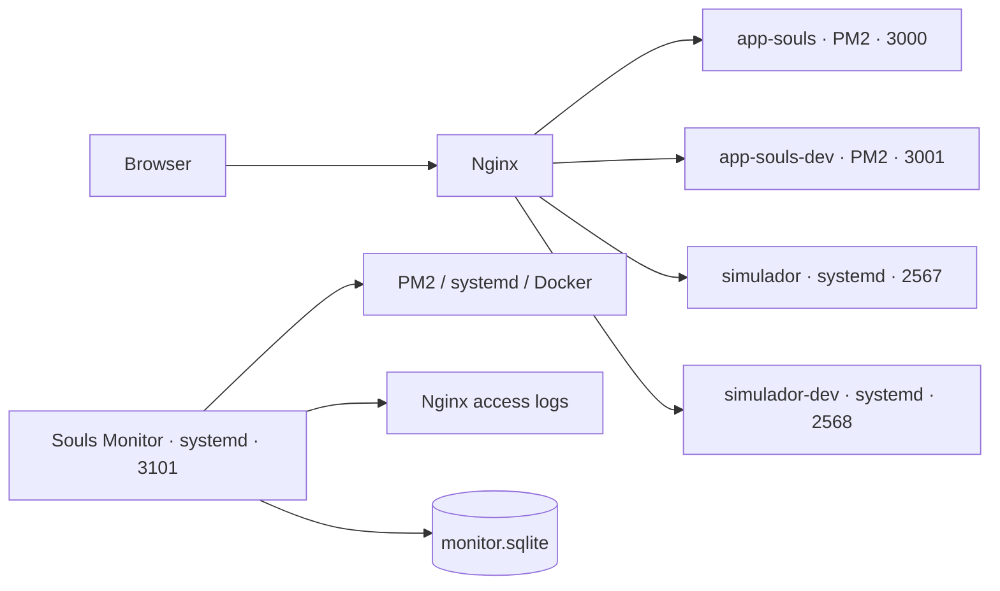

# Arquitectura

## Límites

- `app-souls` y `simulador-souls` son repositorios separados.
- `app-souls` mantiene los datos de usuarios, cartas, decks y torneos.
- El frontend del simulador no accede directamente a MongoDB.
- Souls Monitor solo lee las fuentes operativas y escribe su propia SQLite.

El catálogo de servicios vive en `src/services.ts`; cambiar un dominio, puerto o unidad debe hacerse allí y luego validarse con probes.
