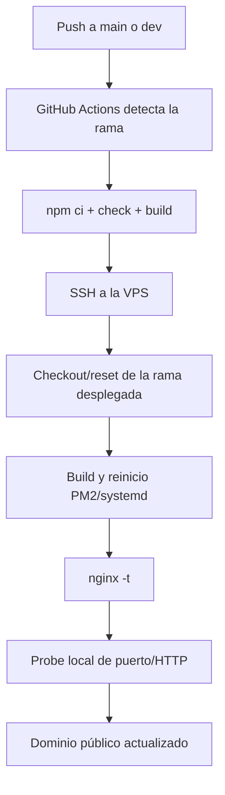

# Despliegues

Los despliegues se ejecutan desde GitHub Actions y terminan en la VPS. Cada
repositorio tiene su workflow; hacer push a un repositorio no despliega los
otros dos.

## Qué rama despliega cada workflow

| Repositorio | Rama | Workflow | Runtime | Puerto local VPS |
| --- | --- | --- | --- | --- |
| `app-souls` | `main` | Deploy app-souls to Contabo VPS | PM2 `app-souls` | 3000 |
| `app-souls` | `dev` | Deploy app-souls development | PM2 `app-souls-dev` | 3001 |
| `simulador-souls` | `main` | Deploy Souls Simulador to Contabo VPS | systemd `souls-simulador.service` | 2567 |
| `simulador-souls` | `dev` | Deploy Souls Simulador development | systemd `souls-simulador-dev.service` | 2568 |
| `Souls-monitor` | `main` | Deploy Souls Monitor to Contabo VPS | systemd `souls-monitor.service` | 3101 |

Todos esos workflows también tienen `workflow_dispatch`, por lo que se pueden
ejecutar manualmente desde GitHub Actions seleccionando la rama correcta.

## Qué pasa después de un push



### `app-souls`

- `main`: actualiza `/opt/apps/app-souls`, ejecuta `npm ci`, build y
  `pm2 startOrReload ecosystem.config.cjs`.
- `dev`: actualiza `/opt/apps/app-souls-dev`, valida `sixDev`, URLs de
  simulador y `SIMULATOR_ADMIN_API_URL` en 2568; después ejecuta build y
  `pm2 startOrReload ecosystem.dev.config.js`.

### `simulador-souls`

- `main`: compila contratos, web y game server, empaqueta la release, actualiza
  `/opt/apps/souls-simulador/current` y reinicia el runtime de producción.
- `dev`: compila con URLs `app-dev` y `wss://ws-simulador-dev...`, crea una
  release bajo `/opt/apps/souls-simulador-dev/releases`, actualiza el symlink
  `current` y reinicia `souls-simulador-dev.service`.

### `Souls-monitor`

`main` actualiza `/opt/apps/souls-monitor`, ejecuta `check` y build, instala las
unidades systemd, reinicia dashboard y collector, y comprueba localmente el
puerto 3101.

## Si hago push y no se despliega

1. Confirma que el commit llegó al repositorio correcto y a `main` o `dev`.
   Un push a una rama feature no dispara estos workflows; un PR tampoco
   despliega hasta que se haga merge a la rama configurada.
2. Abre **GitHub → Actions** y busca el workflow del repositorio. Si no hay
   ejecución, revisa que Actions esté habilitado, que el archivo workflow exista
   en la rama y que el push no haya sido solo local.
3. Usa **Run workflow** (`workflow_dispatch`) y selecciona explícitamente
   `main` o `dev`.
4. Si la ejecución aparece como fallida, identifica el primer paso rojo:

   - **check/build:** corregir código, tipos, tests o lockfile.
   - **SSH/secrets:** revisar `VPS_HOST`, `VPS_PORT`, `VPS_USER`,
     `VPS_SSH_KEY` y `VPS_KNOWN_HOSTS` en el repositorio correspondiente.
   - **validación de entorno:** corregir `sixDev`, origen del simulador o
     URL/puerto 2568 en el `.env` de desarrollo.
   - **reinicio/runtime:** revisar PM2 o systemd en la VPS.
   - **smoke test:** comprobar puerto, logs y respuesta local antes de mirar
     Cloudflare/Nginx.

5. Si hay ejecuciones simultáneas, espera la ejecución más reciente: cada
   workflow usa `concurrency` y puede quedar en cola.

## Diagnóstico seguro en la VPS

```bash
systemctl is-active souls-monitor.service souls-simulador.service souls-simulador-dev.service
pm2 list
ss -ltnp | grep -E ':(3000|3001|2567|2568|3101) '
sudo nginx -t
```

Logs útiles:

```bash
sudo journalctl -u souls-simulador-dev.service -n 80 --no-pager
sudo journalctl -u souls-monitor.service -n 80 --no-pager
PM2_HOME=/home/deploy/.pm2 pm2 logs app-souls-dev --lines 80 --nostream --no-color
```

No ejecutes migraciones, seeds, Prisma ni comandos de mantenimiento de base de
datos como parte de un diagnóstico de despliegue. Primero confirma siempre que
la URL apunta a `sixDev` y no a producción.

## URLs de desarrollo

- [app-dev.soulsinxtinction.com](https://app-dev.soulsinxtinction.com/)
- [simulador-dev.soulsinxtinction.com](https://simulador-dev.soulsinxtinction.com/)
